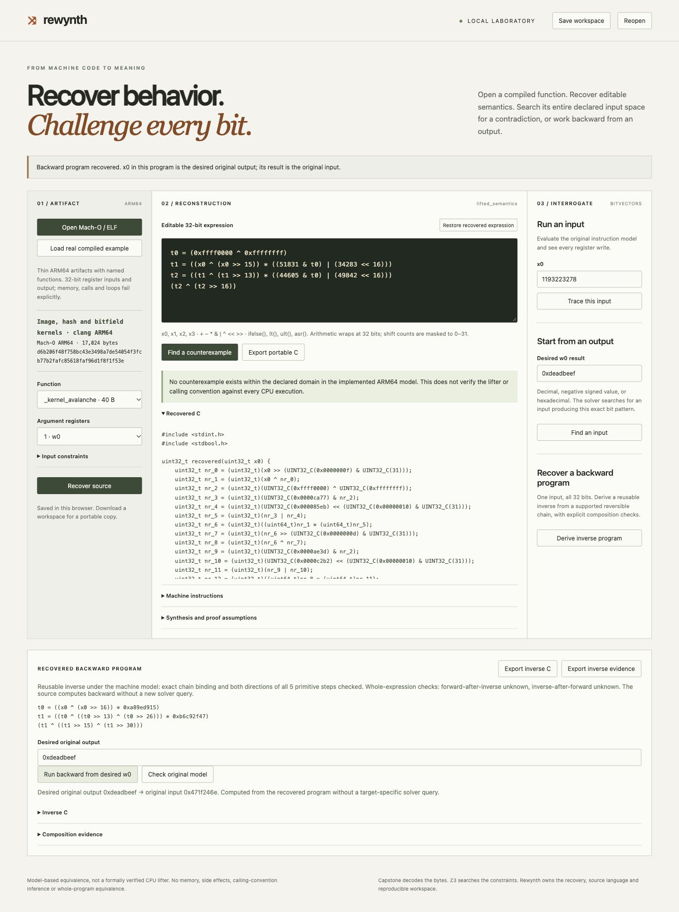

# Rewynth

**Turn compiled integer behavior into source you can run forward or backward.**

Rewynth is a local laboratory for recovering selected ARM64 functions, editing their semantics, finding counterexamples and deriving reusable inverse programs. It reads the original machine instructions as data. No model API, account or cloud service is required.

The shipped demonstration reconstructs image-processing kernels and an xxHash mixing function from actual compiled bytes. A backward program derived from the mixer computes an original 32-bit input from its output without making a new solver query. This reverses the **avalanche transform**, not the complete variable-length xxHash algorithm.



## Run it

Python 3.11 or newer. macOS and Linux are supported for data-only analysis; the example's ARM64 bytes can be analyzed on either architecture. Controlled native fixture tests run only on ARM64 macOS.

```sh
git clone https://github.com/nazeeh111/Rewynth.git
cd Rewynth
python3 -m venv .venv
.venv/bin/python -m pip install .
.venv/bin/rewynth serve
```

Open `http://127.0.0.1:6343/` and choose **Load real compiled example**. There is also a wheel on the [release page](https://github.com/nazeeh111/Rewynth/releases); install that downloaded wheel inside a virtual environment instead of cloning.

To inspect your own artifact, use a thin, little-endian ARM64 Mach-O or ELF with named code symbols. Select the function and explicitly declare its 32- or 64-bit word size and one to four argument registers. Narrow the input domain when the intended use requires it. The workbench binds results to both artifact and function-byte digests.

## A complete experiment

1. Select `_kernel_avalanche`, one argument, all input patterns. Recover its editable source and inspect the actual instructions.
2. Choose **Derive inverse program**. Inspect the extracted reversible chain and its proof records.
3. Enter `0xdeadbeef` as the desired output, then **Run backward from desired w0**. This evaluates the recovered backward program locally. **Trace this input** checks the original instruction model and exposes its register writes.
4. Export forward and inverse C. They are ordinary standalone integer functions, with defined arithmetic and no solver dependency.
5. Change a coefficient or shift in the forward expression and **Find a counterexample**. A result may be a contradicting input, no contradiction within the declared model/domain, or an explicit unknown. Save the evidence and complete workspace to reproduce the experiment.

The workspace includes original artifact bytes, register settings, exact input domains and your edit. Reopening preserves the edit and requires a fresh comparison. Browser recovery keeps the current and previous workspace. Storage failures are visible; manual downloads remain available. Evidence exports contain hashes, constraints and values, so inspect them before sharing private results.

## Recover and rewind a 64-bit state

Choose **Load 64-bit state rewind example**. The selected `_splitmix64_step` is an explicitly marked pure adapter of Sebastiano Vigna's public-domain SplitMix64 step: a prior state is the argument, and the full 64-bit output is the result. Recover its source, derive its inverse, and run backward from `0xe220a8397b1dcdaf` to recover prior state zero. The inverse is derived from the compiled instructions, not from a function-name lookup.

One complete output identifies the prior state. Recovering a historically designated initial seed also requires the call position. Truncated outputs, Raylib's 32-bit values, xoshiro state and cryptographic generators are outside this demonstration. The original stateful `next()` uses memory and remains unsupported; the unchanged source is retained as a separate controlled native oracle.

```sh
rewynth recover --example-wide --function _splitmix64_step --arguments 1 --word-bits 64
rewynth derive_inverse --example-wide --function _splitmix64_step --arguments 1 --word-bits 64
rewynth evaluate --example-wide --function _splitmix64_step --arguments 1 --word-bits 64 --inputs 0x123456789abcdef0
```

[Word-width, exact JSON and workspace contracts](docs/64bit.md) describe the interfaces. Version 1 workspaces reopen as 32-bit; new version 2 workspaces retain the selected width and exact query text. The original 32-bit example is unchanged.

## What the engine does

**Recovery:** Capstone decodes the selected instructions. Rewynth translates its supported 32- and 64-bit register operations into Z3 expressions over bit-vectors (fixed-width machine words), preserving arithmetic flags and conditions. Compact semantic families solve for missing parameters and refine failed hypotheses using solver-produced counterexamples. A general bit-linear learner probes basis vectors, groups the inferred mask/shift/XOR contributions, then checks the complete candidate. Nonlinear functions use a bounded general semantics-to-source fallback. Recovered source uses prior-only bindings to keep shared expressions readable.

**Falsification:** the solver asks whether an input inside the explicit domain makes the original model and edited source produce different output bits. A satisfiable query returns the input, both outputs and a register trace. SAT means a contradicting input exists; UNSAT means no such input exists in the declared model and domain. UNKNOWN means the solver did not decide within its limits. A timeout stays unknown. An empty test set or a handful of successful examples never becomes an equivalence claim.

**Inverse programs:** the engine extracts a reversible single-input chain directly from the lifted expression. It derives modular inverses of odd multipliers and reverses constant addition/subtraction/XOR, constant rotations, full-width bit reversal and self-XOR shifts. Exact chain binding and both directions of every primitive must be checked before compositional inversion is accepted. Whole-expression checks are recorded separately, including timeouts. Lossy operations, unsupported chains and restricted input domains do not receive an all-input inverse claim.

The reusable inverse is computed from the recovered program. The separate **Find an input** operation can also solve a particular output constraint for supported non-bijective or multiple-input functions.

## Scope is explicit

This is a **bounded instruction-model result**, not a formally verified CPU lifter, whole-program decompiler or calling-convention inference system. You select the 32- or 64-bit word size, argument registers and returned `w0` or `x0` bits. In 64-bit mode, writes to a `w` register correctly zero its upper `x` bits; flags and shift masks follow each instruction's operand width. Memory, calls, loops, indirect control flow, floating point, SIMD, ARM64e and unsupported instructions are rejected. Code with unresolved relocations is rejected before analysis. Stripped-symbol and universal-binary boundary recovery are outside this release.

The source language wraps arithmetic modulo 2³² or 2⁶⁴ and masks shift counts to 0–31 or 0–63. Browser computation uses exact BigInt values; 64-bit HTTP inputs and domain bounds must be strings so JSON numbers cannot silently lose bits. Signed and unsigned comparisons are distinct. Imports are never loaded for native execution. CPU comparisons execute only identified public or owned test fixtures and generated C.

The workbench accepts at most 32 MiB per artifact, 4 KiB per selected function and 128 decoded instructions. The source AST (a tree of typed operations and inputs) is bounded to 256 nodes and depth 24. Each analysis runs in an owned cancelable process with a 20-second deadline; Linux additionally imposes a memory limit. The reader applies aggregate symbol and relocation budgets. Sessions and retained jobs are bounded. It binds to loopback and rejects cross-origin writes and unexpected hostnames.

## Evidence

The [validation record](docs/validation.md) separates CPU observations, model checks and unavailable conclusions. The reconstruction and inversion methods have substantial prior work: [FoxDec](https://github.com/ssrg-vt/FoxDec), [STOKE](https://github.com/StanfordPL/stoke), [Syntia](https://github.com/RUB-SysSec/syntia), [rebrew](https://github.com/maci0/rebrew) and [cozy](https://github.com/draperlaboratory/cozy). Rewynth claims no first invention of verified decompilation, synthesis or inversion. Its contribution is the integrated artifact-to-editable-program journey, explicit counterexample and inverse evidence, and a small inspectable implementation with no paid runtime dependency.

[REA](https://github.com/morluto/rea) inspired the ambition to reconstruct behavior from unfamiliar artifacts. Rewynth does not depend on REA or claim to analyze everything.

## CLI

```sh
rewynth inspect --example
rewynth recover --example --function _kernel_avalanche --arguments 1
rewynth derive_inverse --example --function _kernel_avalanche --arguments 1
rewynth evaluate --example --function _kernel_avalanche --arguments 1 --inputs 0x12345678
rewynth inverse --example --function _kernel_avalanche --arguments 1 --target 0xdeadbeef
rewynth verify --example --function _kernel_avalanche --arguments 1 --expression my-edit.txt
```

Replace `--example` with an explicit artifact path. CLI output is JSON; errors exit 2. `verify` reads the bounded source language, never arbitrary Python or C. See [source language](docs/source-language.md) and [architecture](docs/architecture.md).

## Contribute

Public or invented small transforms that expose an incorrect encoding are especially useful. Include instruction bytes, argument/domain declarations, expected result and a minimal witness. Do not upload private artifacts. Run `python -m unittest discover -s tests -v` from an installed checkout. Tests that execute generated C require Clang; native ARM64 fixture checks report skips on other hosts. CI exercises the data-only core on Linux and the controlled native tests on ARM64 macOS.

Built with Codex assistance. Original project code is MIT; fixture excerpts retain stb's MIT and xxHash's BSD-2-Clause notices. Capstone and Z3 retain their upstream licenses. [Provenance](src/native_recovery/resources/examples/provenance.json) records immutable sources and hashes.

If a recovered program is useful in your work, a reproducible example or issue is more helpful than a broad claim. Stars and follows are welcome.
