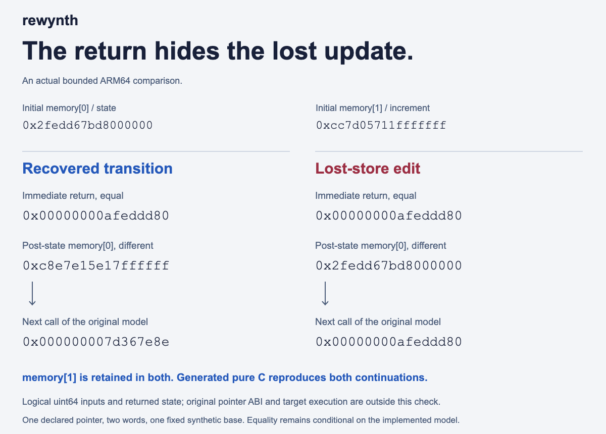

# A matching return can hide a lost update

This actual Rewynth journey reads the bundled ARM64 PCG32 function as data, recovers its return and two declared post-state words, and compares a deliberate lost-store edit. The original library has no demonstrated bug. The edit is ours: leave the return expression unchanged, but replace the first memory expression with `x0`.



[Try the existing browser lesson](https://nazeeh111.github.io/Rewynth/lesson/) · [Actual local workbench](workbench.png) · [Phone state comparison](workbench-mobile.png) · [Complete generated-C example](worked-example.zip) · [Exact evidence](comparison.json)

## Recover, edit, compare all observed effects

Current source parent `e9f4261b9ffda97186fa1ced4cbcfc6a78516189` ran locally with Python 3.12.13, Capstone 5.0.6 and Z3-solver 4.15.3.0. The workbench selected `_pcg32_random_r`, 64-bit words, one machine argument register and two little-endian memory words at the fixed synthetic base `0x100000000`. Logical inputs are the initial state and increment, not a native pointer. The declared input domain is unrestricted for both 64-bit words.

The actual artifact SHA256 is `ace691f7e16518d363ed0582d7a6ab9ee54c2818014b955b2ee886bf31bc556f`; selected function bytes SHA256 `f1f11d9bed12b74c3de0d08c15bfe989080274b1acd58c4517099b1434f48987`. This fixes the inputs to the analysis, not the correctness of the lifter.

The recovered transition passed its implemented-model reconstruction check. After the lost-store edit, the solver returned SAT: a concrete mismatch in `memory[0]`, despite equal architectural X0 returns. For the saved witness:

```text
Initial state:        0x2fedd67bd8000000
Initial increment:    0xcc7d05711fffffff
Both first returns:   0x00000000afeddd80
Original memory[0]:   0xc8e7e15e17ffffff
Edited memory[0]:     0x2fedd67bd8000000
```

`memory[1]` remains the increment in both. Rewynth compares the entire declared post-state, including unchanged words. A return-only comparison would miss this edit. The witness is a solver-produced input, not a minimized or authenticated record.

## The next call is the reveal

Both workbench continuation buttons run the **original instruction model** from one of those post-states. They do not run the edited transition for the next call:

```text
From original post-state: 0x000000007d367e8e
From edited post-state:   0x00000000afeddd80
```

These values come from actual local workbench operations, saved in [browser.json](browser.json). The figure reads [comparison.json](comparison.json) and [native-caller.json](native-caller.json), preserving every full-width value. Its arrows show model continuation, not measured time, CPU execution of the imported artifact or probabilistic confidence. [Editable desktop SVG](lost-update.svg), [phone SVG](lost-update-mobile.svg), [standard-library generator](figure.py).

## Export and rebuild with a caller

The actual workbench downloaded [original.c](original.c), [edited.c](edited.c), comparison evidence and a [version 3 workspace](workspace.rewynth). A fresh browser context reopened the exact edit, retained its artifact/settings/queries, labeled it unverified, and required a new comparison before regenerating C. That fresh comparison again found the state mismatch. Reopening stored evidence is not a fresh proof.

An authored [C11 caller](caller.c) invokes the two exported pure transitions, checks the equal first returns and unequal state, then continues the original transition from both post-states. Existing Apple Clang compiled both exports and the caller; execution matched the workbench values exactly. The original ARM64 object was never loaded or executed. The generated C uses logical `uint64_t` inputs and returns a structure; it does **not** replace the original pointer ABI.

Extract [worked-example.zip](worked-example.zip) to a fresh directory and run:

```sh
python3 rebuild.py
```

Only an existing C11 compiler is required for that generated-source check. Its build runs in a new temporary directory and prints a new execution record. Absolute build paths in the recorded JSON describe the original run; regenerated temporary paths and compiler metadata can differ. Compare the source hashes and numeric results, not the replay record's entire file hash. Every manifest member is included, including the exact fixture as data, saved workspace and original licenses. The bundle was extracted, hashes checked and the caller rebuilt/executed independently.

## Refusal and scope stay visible

The browser recovery was triggered by keyboard Enter. An owned unsupported-header file was refused without replacing the valid artifact or edit. The phone state table remains horizontally scrollable inside its own container; the page itself has no horizontal overflow at 390 pixels. Actual desktop 1440×1100 and phone 390×844 viewport captures are retained. The existing expert workspace and identity needed no demonstrated product repair.

This is one bounded instruction-model result. Memory mode supports one declared pointer, 1–3 consecutive words, concrete in-bounds accesses and at most four logical inputs. Stack/global memory, symbolic/indexed addresses, writeback, atomics, calls, loops, SIMD, floating point and memory inversion remain outside scope. Limits of 128 reachable instructions, 256 edges, bounded expression ASTs and owned 20-second analysis remain unchanged. SAT finds a contradiction; UNSAT is conditional equality in the implemented model/domain; UNKNOWN or refusal establishes no equality. [Full memory contract](../state-transitions.md), [source language](../source-language.md), [engine boundaries](../../README.md#scope-is-explicit).

## Authorship and provenance

The controlled fixture compiles unchanged `pcg32_random_r` from Melissa O'Neill's PCG C basic library at revision `bc39cd76ac3d541e618606bcc6e1e5ba5e5e6aa3`. PCG's source, header, Apache 2.0 notice and exact build provenance remain [in the repository](../../src/native_recovery/resources/examples/memory-provenance.json). PCG already provides advance/rewind facilities; no generator-quality, seed-recovery or original-algorithm claim is made here.

Original Rewynth source/assets are MIT; PCG, Capstone and Z3 retain their upstream licenses and authorship. The separately held engineering branch's witness publication/replay and artifact-admission changes are not merged or claimed by this current-main presentation. The [existing runnable state lab](../../examples/state_lab.py) was also executed and its original four outputs are retained in [state-lab](state-lab/). No unknown/private artifact, process attachment, provider or paid service was used.
